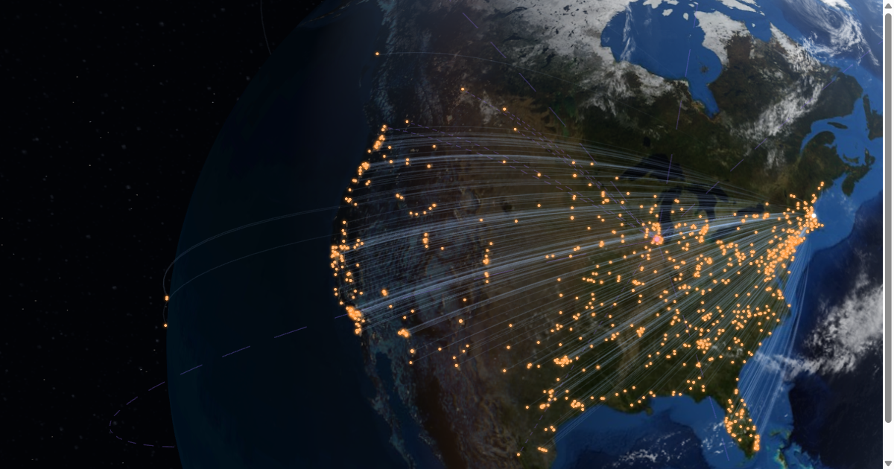

# North Shore Nostalgia Sales Atlas

An interactive spatial analysis of real sales from North Shore Nostalgia, my eBay business. The project maps several years of generalized shipment destinations from Salem, Massachusetts, and combines the resulting geography with operational, console, and aggregate sales indicators.



## What makes this portfolio-ready

- A full three.js scene: a realistic Earth with city lights, clouds, sun glint, and atmosphere
- Order volume, route distance, geographic reach, platform filters, console rankings, search, and temporal playback
- Real generalized sales data from North Shore Nostalgia
- One package per eBay order, with multi-item orders grouped correctly
- City-centroid geocoding and approximate great-circle distance calculations
- Two-stage eBay International Shipping journeys when the export includes both the domestic hub and final country
- A hard privacy boundary enforced in code and tests
- An optional eBay API sync every six hours through GitHub Actions

## Privacy model

The private source may contain names, usernames, email addresses, street addresses, ZIP/postal codes, phone numbers, order IDs, payment details, and tracking numbers. None of those fields are written to the web dataset.

The public file contains only:

- destination city/town, state/region, and country;
- the city centroid rounded to five decimal places;
- sale month (never the exact day);
- game title and quantity;
- approximate city-to-city distance; and
- an optional city-level `via` location for an eBay international handoff; and
- an opaque ID derived only from already-public generalized fields.

The raw eBay export and API response belong in `private/`, which is gitignored. `scripts/build_map_data.py` uses an allow-list for every public package field, and the test suite verifies that representative PII never crosses the boundary.

## Data coverage

The atlas reports known records rather than implying that every sale is present. Safe coverage metadata lives in `data/public-coverage.json` and is embedded into the published dataset on every build. When an export gap is known, the site displays it beside the headline totals and labels those totals accordingly. Remove or update the gap only after a replacement export has been imported.

For eBay International Shipping orders, the pipeline uses the buyer city/region/country as the destination and the domestic ship-to city as a safe handoff point. Older records whose stored export ends at the Illinois hub remain marked as hub-only; the map does not infer or invent their final destinations.

Military mail needs separate handling because eBay records overseas APO/FPO destinations as domestic US addresses. Verified military destinations are matched privately and published only as a broad city/island destination; the retained FPO/AP record is generalized to Okinawa, Japan. The military postal code and unit address never enter the public dataset.

## Run locally

Python 3.11+ is recommended.

```powershell
python -m venv .venv
.venv\Scripts\Activate.ps1
pip install -r requirements.txt

python scripts/build_map_data.py `
  --input "C:\path\to\ebay-all-orders-report.csv" `
  --origin "Salem, Massachusetts, United States"

python -m http.server 8000 --directory public
```

Open `http://localhost:8000`. The first build geocodes each unique city through OpenStreetMap Nominatim at a deliberately conservative rate and caches the results in `data/city-cache.json`. Later builds reuse the cache. Set `GEOCODER_EMAIL` to a contact address when running a substantial batch.

To rebuild without any network geocoding:

```powershell
python scripts/build_map_data.py --input "C:\path\to\orders.csv" --offline
```

## Automatic eBay updates

The scheduled workflow uses the eBay Fulfillment API with its read-only scope. It refreshes a short-lived user access token, retrieves the API's recent rolling order window, generalizes the records, merges them into the safe history, tests the result, and commits only the public JSON and city cache.

1. Create production application keys in the eBay Developers Program.
2. Complete eBay's authorization-code consent flow with this scope:
   `https://api.ebay.com/oauth/api_scope/sell.fulfillment.readonly`
3. Add repository secrets named `EBAY_CLIENT_ID`, `EBAY_CLIENT_SECRET`, and `EBAY_REFRESH_TOKEN`.
4. Optionally add `GEOCODER_EMAIL` for Nominatim identification.
5. In **Settings → Pages**, choose **GitHub Actions** as the publishing source. The included deployment workflow tests the privacy boundary and publishes `public/` on every relevant push.

The refresh workflow runs at minute 17 every six hours and can also be triggered manually. It fetches, generalizes, tests, commits safe changes, and deploys the refreshed Pages artifact in the same run. If the three required eBay credentials are missing, the workflow fails visibly instead of returning a misleading successful run. This last detail is intentional: GitHub does not start another workflow or Pages build from a commit pushed with the default `GITHUB_TOKEN`. Credentials and raw responses are never committed.

Official references: [eBay Fulfillment API](https://developer.ebay.com/develop/api/sell/fulfillment_api), [eBay OAuth authorization](https://developer.ebay.com/develop/guides-v2/authorization), and [Nominatim usage policy](https://operations.osmfoundation.org/policies/nominatim/).

## Tests

```powershell
pytest -q
```

The tests cover package grouping, approximate distance, safe-history merging, the checked-in output schema, and representative PII exclusion.

## Globe implementation, projection, and distance

The site has no build step. `public/globe.js` loads three.js 0.170.0 through an import map and renders everything: Earth, clouds, atmosphere, stars, sun, routes, and destination lights. Earth imagery is loaded at runtime from the pinned `three-globe@2.45.0` package on jsDelivr. Scrolling moves the camera, so the page stays one continuous scene.

Coordinates are stored in WGS 84 (EPSG:4326). Routes are great-circle arcs lifted slightly off the surface, and each one fades near Salem so hundreds of shared start points do not merge into a solid shape. Distances use the same great-circle model and are approximate city-to-city measurements rather than road mileage or carrier routes.
